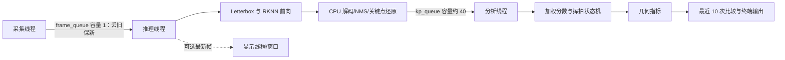
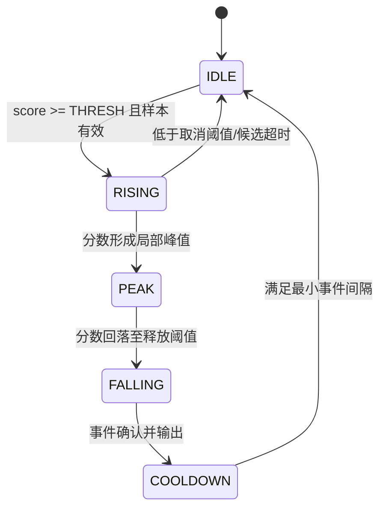

# RK3568 + IMX415 挥拍快照分析器：第一版修订方案

## 1. 目标与修订说明

在 RK3568 上使用 IMX415 采集，复用 YOLOv8-pose RKNN 输出的 COCO 17 关键点，检测是否发生一次挥拍，计算三个二维人体指标，并与本人最近 10 次有效事件的均值比较，及时输出中性反馈。

本文是第一版修订方案，只定义需求和设计，不实现代码。硬件帧率、触发阈值及效果数据都须按本方案验证，未经实测不视为产品事实。

本次修订统一第一版边界：只检测“是否挥拍”，不分类正手/反手/削球；只比较个人历史，不匹配标准模板、不输出绝对对错；固定单机位、单人入镜，手动指定持拍手。允许低帧率工作，关键点有效输出帧率目标 ≥ 8 FPS。

## 2. 需求和能力边界

### 2.1 功能需求

| 编号 | 需求 | 第一版完成条件 |
| --- | --- | --- |
| R01 | IMX415 采集及模型初始化 | 目标板能打开选定采集模式；能加载 RKNN 模型；初始化错误可见 |
| R02 | 关键点推理 | 输出一个已锁定练习者的 COCO 17 点坐标、置信度、帧时间戳及实际关键点 FPS |
| R03 | 持拍侧配置 | 用户以配置常量/启动配置手动选择右手或左手；不自动判断惯用手 |
| R04 | 挥拍事件检测 | 加权运动分数与双阈值状态机识别一次候选挥拍；事件带峰值、时间和有效性 |
| R05 | 指标计算 | 对每个有效事件尝试计算转体角度、手腕相对高度、随挥方向/幅度；每项单独标记有效或原因 |
| R06 | 个人历史比较 | 三项有效指标分别与本人最近 10 次同条件有效事件的算术均值比较；当前事件完成比较后再加入历史 |
| R07 | 结果输出 | 终端输出事件状态、指标、有效性、与近 10 次均值的差值及简短反馈 |
| R08 | 可选显示 | OpenCV 窗口和骨骼/文本叠加可独立关闭；关闭显示不得停止采集、推理、触发及指标计算 |
| R09 | 本地标定 | 冷启动阶段收集有效峰值，阈值可保存至 calib.json；配置与样本版本可追溯 |
| R10 | 异常处理 | 摄像头断流、低 FPS、关键点无效和标定样本不足均有可见状态，不产生伪指标 |

### 2.2 第一版明确不做

- 不区分正手、反手、削球或其他击球类型，不承诺动作类型准确率。
- 不引入“标准挥拍”模板，不输出动作好坏、是否规范等绝对评价。
- 不自动检测持拍手、不支持多人同时分析；ROI 内保持一个人和一个稳定目标。
- 不推断真实触球时刻、球拍/球位置、拍头速度、球速或三维转体角度。
- 首版交付以终端反馈为主；OpenCV 实时画面为可关闭的调试显示，不要求浏览器、网络服务、历史图库或连续视频归档。

### 2.3 2D 跨人泛化边界与风险依据

给定资料中的论文消融结果显示，在该击球类型识别任务上，使用 2D 图像坐标时跨选手准确率由世界坐标方案的 83% 降至 47%。这说明二维投影和选手差异会显著限制跨人动作类别泛化。该结果用于界定风险，不等同于本系统挥拍检测或三个指标的实测效果，也不能直接外推为本系统的准确率。

因此第一版仅在固定视角、固定练习者设置、同一人的时间序列内，验证“是否发生挥拍”和个人指标是否有合理相对变化。不同人的绝对角度/高度不可直接比较；正手/反手识别准确率不作为需求或验收项目。局部遮挡、侧视关节重叠、手腕检测跳点和不同人与相机的距离仍会造成无效事件或指标波动，必须单独统计。

## 3. 总体架构与线程边界

采用单进程三线程、两级有界队列。首版优先使用现有 C++/OpenCV/RKNN 推理与 CPU 后处理；显示是分析的旁路消费者。

| 线程/模块 | 职责 | 并发约束 |
| --- | --- | --- |
| 采集线程 | 读取 IMX415、打帧序号和单调时间戳，提交最新原始帧 | `frame_queue(maxsize=1)` 满时丢弃旧帧；相机格式与尺寸变更记入配置 |
| 推理线程 | 图像预处理、RKNN 前向、CPU 后处理、关键点坐标映射和置信度过滤 | 单实例管理 RKNN 上下文；给关键点结果附源帧 ID 与时间戳 |
| 分析线程 | 目标稳定性检查、运动特征、状态机、事件去重、指标、历史比较和文本结果 | `kp_queue(maxsize≈40)`；满时不允许无限增长，记录溢出及时间缺口 |
| 显示消费者 | 可选地画骨骼、状态、指标文本并刷新窗口 | 只消费最新帧/结果；可关闭；不得持有分析锁或反压推理线程 |

分析队列 40 项是容量上限，不是必须积压 40 帧才处理。消费者应及时取样；过载时丢弃最旧姿态样本并显式记录缺口，速度不得跨较大缺口计算。队列保留时间会随实际 FPS 变化，必须监测队列深度、最老样本年龄和丢弃数。

模块间数据契约按职责分层：采集帧包含 `frame_id`、单调时间戳、实际宽高、像素格式和方向配置；推理结果包含同一 `frame_id`、人体框、COCO 17 点坐标/置信度及有效掩码；事件结果包含触发状态、峰值分数与时间、逐项指标、有效性/原因和使用的历史样本数。队列传递不可变数据或明确所有权的帧缓冲，显示消费者不得反向控制触发状态。模型推理与 CPU 后处理仍视为同一推理线程阶段，以避免共享 RKNN 上下文；后处理完成后才将关键点样本送入分析队列。

## 4. 采集、模型与关键点约定

### 4.1 采集和部署

- 目标平台为 RK3568 Linux，模型为 YOLOv8n-pose ONNX 转换的 INT8 RKNN。转换命令参考：`python convert.py ../model/yolov8n-pose.onnx rk3568 i8`；具体工作目录和工具版本按仓库脚本确认。
- 先独立验证 IMX415，再接入推理：优先用板卡厂商/官方提供的 GStreamer 命令确认出图、格式、尺寸和实际帧率；记录 `/dev/video*` 节点、媒体链路及使用的采集模式。
- OpenCV 优先尝试 `CAP_V4L2` 并显式请求已验证的尺寸和像素格式；若驱动不接受所请求格式，不假定协商成功，要读取实际格式并报告。可优先评估 NV12，最终以 ISP/V4L2 节点支持情况为准。
- IMX415 模组及底板组合需核实 PCB 丝印版本，资料提示模组要求 V1.5 或更新；不能仅由摄像头型号推断驱动已适配。
- 采集采用实际帧时间差计算所有速度和时长；不按“理想 FPS”将帧号差直接当固定时间。

### 4.2 RKNN 推理与 CPU 后处理

复用 `rknn_model_zoo/examples/yolov8_pose` 中的预处理、RKNN 推理接口和后处理。网络前向由 NPU 执行；DFL 解码、NMS、COCO 17 点解析及坐标反变换由现有 CPU 后处理路径完成。每个人体结果至少带检测框、17 点 x/y/置信度、源帧 ID 和时间戳。

首版固定机位单人：在 ROI 内选择并持续关联一个人体。出现多人歧义或跟踪对象切换时，重置速度历史和候选事件，不拼接不同人的轨迹。

### 4.3 COCO 17 点及左右手映射

COCO 关键点编号按 0 起始：`5` 左肩、`6` 右肩、`7` 左肘、`8` 右肘、`9` 左腕、`10` 右腕、`11` 左髋、`12` 右髋。配置常量 `HANDEDNESS` 显式指定持拍手：右手使用肩/肘/腕 `6/8/10`，左手使用 `5/7/9`；髋中心使用 `11/12`。实现和离线数据读取都须使用同一份 0 起始约定，避免和一基索引混淆。

坐标采用方向修正后的分析图像坐标：左上原点、x 向右、y 向下；显示镜像不得交换 COCO 左右语义。记录每个点的置信度。关键点缺失、置信度不足或人体目标改变时，将相应样本标为无效。

## 5. 触发层与参数

### 5.1 运动特征与评分

针对手动指定的持拍侧，计算手腕、肘、肩图像坐标的时间域速度。为降低相机距离和人体框尺寸差异，推荐先以人体框高度或肩髋尺度归一化坐标，再按单调时间差求速度。速度单位和归一化方式必须在实现中固定并写入算法版本。

初始加权运动分数：

`score(t) = 0.5 * v_wrist(t) + 0.3 * v_elbow(t) + 0.2 * v_shoulder(t)`

其中各速度均是对应关节相对身体尺度归一化后的速度幅值。打分时腕、肘、肩三点都需满足置信度门槛；不满足则该时刻不参与触发。加权系数是起始设计值，需在独立调参数据上评估，不视为论文提供的最优值。

关键点基础置信度门槛为 `KP_CONF_THRESH=0.3`。腕/肘/肩任一点低于门槛时，本时刻触发评分无效；指标另按各自所需点做有效性判定。可评估 3 帧滑动平均降抖，但平均结果需保留其时间对齐和延迟，不可直接覆盖原始样本。

### 5.2 状态机

使用双阈值滞回状态机：

`THRESH` 为上阈值，绝对释放阈值 `LOW_THRESH` 低于上阈值以形成滞回；候选释放阈值取 `max(LOW_THRESH, 0.5 × candidate_peak_score)`，使动作分数相对本候选峰值明显回落时即可进入确认，避免关键点噪声长期高于固定低阈值导致候选超时。候选还需有最小持续时间和显著运动幅度，避免单帧噪声触发。检测一次挥拍后应等分数回落，再进入冷却；事件在局部峰值及回落条件满足后确认，峰值时间作为参考时刻，不宣称是触球时刻。

阈值含义须与标定数据一致：若对 `score` 标定，就对每次候选的 `peak_score` 取中位数；不得把绝对速度峰值与归一化阈值混用。

### 5.3 40 帧间隔、冷却与冷启动

论文给出的 40 帧最小击球间隔可作为冷启动阶段防合并的参考，不是所有 FPS 下固定等待 40 帧。标称 15 FPS 时 40 帧约为 2.7 秒；系统按实测帧率和帧时间戳将该参考换算为时间域。低 FPS 下这段时间会更长，可能合并连续挥拍，因此须统计其对召回率的影响。

正式模式默认 `MIN_SWING_INTERVAL=0.8 s`，以事件时间戳执行，不使用固定帧数。冷启动阶段采用 40 帧间隔参考及更严格的候选质量筛选；三次有效标定挥拍之后切到正式时间域冷却。阈值标定和冷却策略是两个独立控制量，不能因为采用 40 帧参考而把正式模式冷却也固定为 40 帧。

冷启动修正规则：

1. 初始 `THRESH` 低阈参考值暂定约 `0.03`，并设候选峰值最低门槛，避免微小噪声进入标定。参考资料中的业余/职业约 `0.04/0.08` 只有在运动分数定义、尺度和预处理一致时才可对照；分数定义不一致时不得直接套用。
2. 收集 3 次满足目标稳定、关键点有效、持续时间及幅度条件的候选峰值，只记录峰值，不计算/反馈三个动作指标。无效、重复、多人歧义和低置信度候选不计入样本数。
3. 三个有效峰值到齐后，取 `median_peak`，计算 `THRESH = 0.6 * median_peak`，将阈值、峰值样本、FPS 范围、相机/模型/算法配置和版本保存至 `calib.json`。`THRESH` 不得低于配置的最低有效门槛；若标定样本过少或峰值分布不稳定则继续未标定状态并提示，不悄然启用不可信阈值。
4. 第 4 次及之后进入正常分析，并启用 `MIN_SWING_INTERVAL=0.8 s`。运行帧率明显偏离标定范围时，标定仍可用于幅值阈值的条件需由验证确认；未经确认则提示重新标定。

参数汇总：

| 参数 | 初始值 | 说明 |
| --- | --- | --- |
| `HANDEDNESS` | `RIGHT` 或 `LEFT` | 手动指定；每次训练显式记录 |
| `KP_CONF_THRESH` | `0.3` | 触发所需腕/肘/肩及指标关键点的基础门槛 |
| 评分权重 | 腕 0.5、肘 0.3、肩 0.2 | 用于 `score(t)`，待回放调参 |
| 冷启动样本数 | 3 次有效候选 | 冷启动期只标定，不输出动作指标 |
| 最低候选峰值 | 约 0.03 起评估 | 必须与所定义 score 标度一致，待本机验证 |
| `THRESH` | `0.6 × median_peak` | 三次有效峰值中位数乘系数，配置版本化 |
| 冷启动间隔参考 | 40 帧 | 依实际 FPS 换算；15 FPS 下约 2.7 秒 |
| `MIN_SWING_INTERVAL` | 0.8 秒 | 正式模式的时间域最短事件间隔 |
| `FOLLOW_THROUGH_FRAMES` | 2 帧 | 峰值后取样帧数；需同时检查时间间隔和关键点有效性 |
| `HISTORY_SIZE` | 10 | 每项指标分别维护最近 10 个有效历史值 |
| 平滑窗口 | 可选 3 帧 | 引入后须记录时间对齐和延迟 |

`FOLLOW_THROUGH_FRAMES=2` 只定义基础随挥测量的候选偏移，不保证低 FPS 下有足够的时间跨度。必须同时记录两帧对应时间；若跨度不足、跟踪丢点或位移低于测量噪声阈值，则随挥方向无效，不得把“第 2 帧”描述成固定时长。

## 6. 指标层与实现路径

#### 几何计算来源与移植边界

几何计算参考 `sport-vision` 项目中的 `pose_analyzer.py`：借鉴其从人体关键点计算关节角度、手腕位置/速度及时间变化量的思路，用这些几何量描述动作过程。本项目的输入替换为 YOLOv8-pose 输出的 COCO 17 点坐标、每点置信度和采集时间戳；关节索引、左右手映射、缺失点处理、坐标归一化及有效性规则均按本方案重新定义，并用离线已知几何用例和连续序列回放验证。

该来源是几何计算思路，不是运行时或算法依赖：不引入 MediaPipe 运行时，不要求其 landmark 格式，不复制其与 13 关键点拓扑绑定的挥拍触发规则。挥拍触发仅由本方案第 5 节的 COCO 17 点加权速度分数、冷启动标定和双阈值状态机负责；来源代码的触发结果不参与判定。实现时记录所参考的仓库版本/提交及具体计算思路，避免把“借鉴”误写成代码或模型依赖。

### 6.1 通用有效性规则

- `KP_CONF_THRESH=0.3` 作为首版关键点置信度门槛；每个指标按所需点独立判断有效。某指标所需点任一点不满足门槛、坐标非有限、骨段长度过短或事件时间缺口过大时，该项无效并写明原因。
- 触发评分使用腕、肘、肩；转体角使用双肩和双髋；相对高度使用持拍侧腕和双髋；随挥方向使用持拍腕在峰值和峰值后样本。指标不可用不应反过来伪造触发点。
- 原始坐标、归一化坐标、关键点置信度和滤波值分开保存，便于核查。角度/高度计算使用人体尺度归一化，结果和所用尺度一起记录。
- 每项输出包括数值、单位/定义、有效标志、参与的样本时间和无效原因；冷启动阶段不计算指标。

### 6.2 三项指标定义

| 名称 | 第一版定义 | 主要限制 |
| --- | --- | --- |
| 转体幅度 | 对每个有效样本计算肩线和髋线的无向二维夹角 `theta(t)`，固定范围 0～90°；事件幅度为挥拍窗口内有效最大夹角减准备段中位夹角 | 受视角、遮挡和肩髋线段投影长度影响；是投影几何量，不是真实躯干旋转角 |
| 击球点高度 | 以手动指定持拍侧手腕在运动分数峰值时的归一化图像高度 `h = 1 - y_norm` 输出，`y_norm` 按人体框/约定 ROI 高度归一化到 [0,1] | 代表峰值时刻手腕在画面中的高度，不代表球拍或真实击球点；跨机位、跨人绝对值不可比 |
| 随挥方向/幅度 | 速度峰值后 `FOLLOW_THROUGH_FRAMES=2` 对应样本与峰值样本的持拍侧手腕位移 `(dx,dy)`；方向可输出 `atan2(-dy, dx)`，幅度以人体尺度归一化位移表示 | 需两帧有效且有足够时间/位移；低 FPS 下两帧时间跨度不恒定；仅为 2D 手腕方向 |

肩线、髋线均由左右对应 COCO 点构成。令肩线向量 `a = right_shoulder - left_shoulder`、髋线向量 `b = right_hip - left_hip`，使用 `theta = atan2(abs(cross(a,b)), abs(dot(a,b)))` 计算无向线夹角，结果固定在 0～90°，避免端点顺序变化造成角度跳变。当任一线段长度低于人体尺度相关门槛时判无效。事件转体幅度定义为挥拍候选窗口内有效 `theta` 最大值减候选前稳定准备段 `theta` 中位值；准备段不足或两个髋/肩不全时该指标无效。

高度使用与方向修正一致的图像坐标。若 `y_norm=(y-y_roi_top)/roi_height`，则 `h=1-y_norm`；ROI 和画面方向变化应创建新的比较条件。髋点 y 使用双髋有效点的均值，单侧髋缺失时首版建议该高度项无效，避免定义漂移。

### 6.3 个人历史均值比较

每个指标维护独立的最近 `HISTORY_SIZE=10` 个有效事件数值。一个事件仅在相应指标有效后进入该指标历史；例如肩髋被遮挡时，不应阻止有效的腕部高度进入其历史。

在处理当前事件时，先读取已有历史均值，再计算 `delta = current_value - mean(previous_values)` 和相对变化（仅在均值远离零且定义支持时计算），形成反馈文本，随后才将当前有效值压入对应历史并截断至最近 10 项。样本少于 10 项时也可显示当前均值和 `N/10` 样本数，但必须明确是暂存均值，不声称已有完整 10 次基线。

历史分组至少绑定惯用手、相机/机位标识、采集分辨率与 ROI、方向变换、模型版本、算法/阈值版本。机位或配置显著变化时新建历史组，不混合个人时间序列。首版比较算术均值以符合需求；可另记录标准差用于波动提示，但不把均值差解释为好坏。

推荐反馈：“本次手腕相对高度 0.62；比本人最近 10 次有效事件均值高 0.04（躯干/ROI 归一化单位）”。如果历史不足写“当前有效样本 N/10”；指标无效写原因，不生成比较句。

## 7. 输出和可选显示

终端是首版主要交付界面：启动时输出设备、模型、输入格式、实际帧率、持拍手和阈值状态；运行时按事件打印触发时间、峰值分数、三个指标值/有效性、历史样本数、均值与差值；周期打印关键点 FPS、队列深度/溢出和丢帧数。

OpenCV 显示可独立启停。开启时可显示检测框、COCO 骨骼、持拍侧肩肘腕、状态机状态和最新指标；关闭时不创建窗口、不执行绘制/显示同步等待，采集、推理、分析与终端输出仍照常工作。显示消费者只读取最新帧和不可变结果快照，任何刷新失败或慢客户端不能阻塞分析线程。

## 8. 离线验证方案

离线验证分成“单帧几何公式”和“连续序列触发逻辑”两条路径；数据集用于算法函数及回放验证，不取代 RK3568/IMX415 在线验证。

### 8.1 Tennis Player Actions Dataset：几何计算

按给定资料，该数据集约 503 MB，提供 COCO JSON 和图像，标注 18 点（COCO 17 点加 neck）。实现离线读取器，将其 COCO 兼容 17 点映射为本项目 0 起始索引；neck 仅忽略。对 right wrist/elbow/shoulder 和双髋坐标及可用的对侧肩点，验证转体角、腕部归一化高度、输入置信度过滤、缺点/退化线段时的无效处理。

测试不仅检查“函数返回有限数字”，还需构造已知几何用例：肩线与髋线平行时角度为 0°；正交时为 90°（若采用无向线定义）；坐标平移不改变角度；统一缩放不改变角度及尺度归一化高度；点交换不会造成角度突跳；y 坐标向下时图像上方的手腕得到更高的 `1-y_norm`。手腕高度和图像夹角只验证定义一致性，不以静态图片宣称挥拍动作质量有效。

读取数据时检查标注索引基准、遮挡/不可见标签及左右语义。若源 JSON 的置信度/可见性字段语义与模型置信度不同，不将它们伪装成相同概率；分别生成可见性掩码或按该数据集规则筛样。

### 8.2 THETIS 2D 骨架序列：触发回放

将 THETIS 连续骨架映射到算法实际需要的 COCO 17 点子集，优先映射持拍侧肩、肘、腕和双髋。源骨架缺少的点标为缺失，不用复制邻点补齐。逐序列保留原始时间/FPS；若只有帧序号，需明确采用的数据集帧率，并在至少两个重采样 FPS 下重复回放，检查 40 帧规则的时间换算和正式 0.8 秒冷却。

把映射后的坐标和时间戳送入同一 `score(t)` 与状态机实现，观察事件是否在人工标注动作中段附近触发。给定方案验收门槛：10 段正手序列中至少 6 段在动作中段触发。该小样本是触发逻辑冒烟验收，不代表跨人泛化结论；若数据许可，应另报告非挥拍/其他动作误触发。

THETIS 骨架点若缺少 YOLO 的检测置信度，使用显式的“序列点可用性”掩码，不能伪造模型 confidence；需单独运行纯坐标触发回放和带缺失模拟回放，以评估算法对遮挡/丢点的处理。

### 8.3 RK3568 + IMX415 在线验证

在目标板先用独立采集命令验证摄像头版本、节点、像素格式、分辨率和 FPS，再运行完整链路。统计端到端有效关键点 FPS、推理/CPU 后处理耗时、最大队列深度、丢帧、阈值标定值及显示开关前后吞吐。显示关闭时分析链路必须继续工作。

固定一位练习者、机位、持拍手和采集配置，进行 10 次真实挥拍，人工记录挥拍数及逐事件触发结果，按一对一匹配统计召回率和精确率；同时记录重复触发、漏触发和三个指标有效率。每次真实挥拍的指标变化仅作合理性观察，不用 10 次小样本声称跨人或专业生物力学有效性。

## 9. 风险与应对

| 风险 | 影响 | 应对及验证 |
| --- | --- | --- |
| 2D 坐标跨人泛化差 | 动作类别和绝对几何量对不同人的迁移不可靠；给定击球类型消融结果为 83%（世界坐标）降至 47%（2D） | 第一版取消正反手分类和标准模板；单人同机位做个人历史比较；验收不考核类别准确率 |
| 低 FPS 稀释速度峰值 | 峰值漏采，触发召回下降，随挥两帧跨度变化 | 用真实时间戳算速度；标定使用目标板实际 FPS；低 FPS 下单独统计召回与指标有效率；关键点 FPS 门槛定为 ≥ 8 |
| 冷启动 40 帧间隔随低 FPS 变长 | 连续挥拍可能被合并 | 40 帧仅为冷启动参考并按实测 FPS 换算；正式模式按 0.8 秒时间域间隔；在线测试连续动作影响 |
| 冷启动误触发污染标定 | 阈值过高或过低，后续漏检/误检 | 峰值最低门槛、三点置信度及持续/幅度门控；三次有效峰值取中位数；保存样本和版本；分布异常不自动启用 |
| 标定阈值与 score 标度不匹配 | `0.03/0.04/0.08` 参考值无意义 | 固定速度归一化、权重和坐标定义后才解释数值；版本变化触发重标定 |
| IMX415 PCB/底板版本不适配 | 摄像头无法出图或不稳定 | 核验模组丝印 ≥ V1.5 及板端适配；先跑独立 GStreamer 验证 |
| V4L2/OpenCV 格式或帧率协商异常 | 偏色、花屏、吞吐低于目标 | 优先验证 NV12 等硬件实际支持格式；显式设置并读取协商结果；必要时降分辨率 |
| 关键点抖动、遮挡或目标切换 | 伪速度峰值和无效指标 | `KP_CONF_THRESH=0.3`；3 帧平滑作为可选项；跟踪 ID 改变即清空速度历史和候选 |
| 显示拖慢推理 | FPS 降低、队列积压 | 显示独立旁路、只取最新帧、允许完全关闭；测试开/关对比 |
| 40 项姿态队列积压 | 分析结果过期、速度跨缺口 | 监测最老样本年龄和溢出；丢弃旧值并按时间戳拒绝跨缺口速度 |
| 小样本/数据域差异 | 离线结果不代表板端表现 | 几何单测、THETIS 回放和在线实测分开报告；不混为同一准确率 |

## 10. 参数与验收标准

### 10.1 参数基线

| 参数 | 修订基线 |
| --- | --- |
| 输入关键点 | YOLOv8-pose RKNN，COCO 17 点 |
| 目标平台/相机 | RK3568 Linux + IMX415，单机位单人 |
| 持拍手 | `HANDEDNESS` 手动指定 |
| 关键点输出 FPS | 目标 ≥ 8 FPS，实测记录，不足时仍输出状态但报告采样受限 |
| 队列 | `frame_queue=1`；`kp_queue≈40`，均有溢出和丢弃计数 |
| 置信度 | `KP_CONF_THRESH=0.3` |
| 触发评分 | `0.5*v_wrist + 0.3*v_elbow + 0.2*v_shoulder` |
| 冷启动 | 3 次有效峰值；最低候选门槛约 0.03 待定标度验证；`THRESH=0.6×median_peak` |
| 间隔 | 冷启动参考 40 帧并按 FPS 换算；正式 `MIN_SWING_INTERVAL=0.8 s` |
| 随挥采样 | `FOLLOW_THROUGH_FRAMES=2`，另检查真实时间差和有效位移 |
| 历史 | 各指标独立保存最近 10 个有效事件，输出算术均值和差值 |
| 显示 | 可独立关闭；关闭不影响分析链路 |

### 10.2 第一版通过条件

1. 终端能稳定输出 COCO 17 点结果、关键点有效 FPS 及采集/队列状态；关键点输出帧率达到 ≥ 8 FPS。
2. 单人固定场景下，10 次真实挥拍在线测试召回率 ≥ 60%、精确率 ≥ 70%；必须同时报告误触发、重复触发、漏触发和指标有效率。
3. 每次有效触发对三个指标分别给出数值或明确无效原因；指标有效时输出与本人最近 10 次有效事件均值的比较。历史不足 10 次时明确显示当前 N/10 样本数，不冒称完整 10 次均值。
4. 不考核正手/反手/削球分类准确率，不考核“绝对动作正确性”；验证目标是事件触发和同一人的相对指标变化是否合理。
5. 连续运行 10 分钟不崩溃；采集/推理/分析线程队列有界，不因显示开启造成阻塞；显示关闭时分析和终端输出持续运行。
6. 离线几何测试通过已知输入/输出及无效输入用例；THETIS 10 段正手回放至少 6 段在动作中段触发。离线门槛与在线 10 次指标分开报告，不以其替代在线验收。

## 11. 实施顺序

1. 核验 IMX415 硬件版本和板端采集模式，独立测出格式、尺寸及实际 FPS。
2. 复用 RKNN 模型转换/推理和 COCO 17 点 CPU 后处理，验证坐标、左右手索引及关键点 FPS。
3. 先完成已知坐标几何测试，再实现单人持拍侧特征、阈值标定和状态机回放。
4. 接入个人最近 10 次有效指标环形历史与终端反馈；最后接入可关闭显示旁路。
5. 按离线几何、THETIS 连续序列、RK3568 + IMX415 在线三层验证，冻结模型、相机、FPS、算法参数及验收记录。

以上为修订后的第一版方案；任何超出单人同机位挥拍检测与自身历史比较的动作分类或绝对评价需求，应另行定义数据、模型和验收标准。
