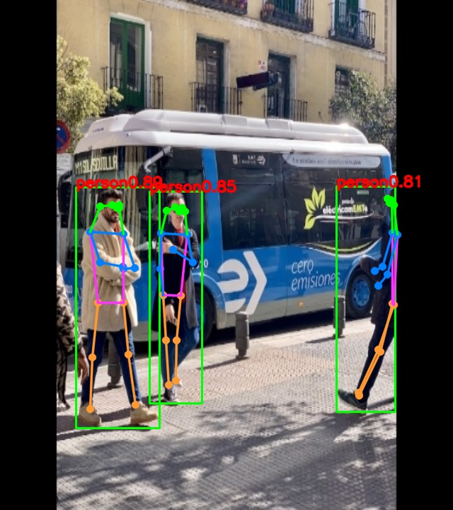

# yolov8_pose

## Experimental tennis swing counting

The camera demo supports single-person, calibrated forehand/backhand **swing**
counting with counts rendered into the MJPEG preview. It does not detect ball contact.
See [中文使用说明](TENNIS_SWING_USAGE_ZH.md) for configuration, calibration,
controls, replay tests and validation limits.

```bash
./rknn_yolov8_pose_demo model/yolov8n-pose.rknn camera 0 8080 --tennis-config configs/tennis_pose.conf
```

## Table of contents

- [1. Description](#1-description)
- [2. Current Support Platform](#2-current-support-platform)
- [3. Pretrained Model](#3-pretrained-model)
- [4. Convert to RKNN](#4-convert-to-rknn)
- [5. Python Demo](#5-python-demo)
- [6. Android Demo](#6-android-demo)
  - [6.1 Compile and Build](#61-compile-and-build)
  - [6.2 Push demo files to device](#62-push-demo-files-to-device)
  - [6.3 Run demo](#63-run-demo)
- [7. Linux Demo](#7-linux-demo)
  - [7.1 Compile \&\& Build](#71-compile-and-build)
  - [7.2 Push demo files to device](#72-push-demo-files-to-device)
  - [7.3 Run demo](#73-run-demo)
- [8. Expected Results](#8-expected-results)


## 1. Description

The model used in this example comes from the following open source projects:  

https://github.com/airockchip/ultralytics_yolov8

yolov8n-pose pt model download link: 

[yolov8n-pose.pt](https://github.com/ultralytics/assets/releases/download/v8.2.0/yolov8n-pose.pt)<br />


## 2. Current Support Platform

RK3562, RK3566, RK3568, RK3576, RK3588, RV1126B


## 3. Pretrained Model

Download link: 

[./yolov8n-pose.onnx](https://ftrg.zbox.filez.com/v2/delivery/data/95f00b0fc900458ba134f8b180b3f7a1/examples/yolov8_pose/yolov8n-pose.onnx)

Download with shell command:

```
cd model
./download_model.sh
```


## 4. Convert to RKNN

*Usage:*

```shell
cd python
python convert.py <onnx_model> <TARGET_PLATFORM> <dtype(optional)> <output_rknn_path(optional)>

# such as: 
python convert.py ../model/yolov8n-pose.onnx rk3588
# output model will be saved as ../model/yolov8n-pose.rknn
# Currently the C code demo only supports 8-bit quantization
```

*Description:*

- `<onnx_model>`: Specify ONNX model path.
- `<TARGET_PLATFORM>`: Specify NPU platform name. Support Platform refer [here](#2-current-support-platform).
- `<dtype>(optional)`: Specify as `i8` or `fp`. `i8` for doing quantization, `fp` for no quantization. Default is `i8`.
- `<output_rknn_path>(optional)`: Specify save path for the RKNN model, default save in the same directory as ONNX model with name `yolov8n-pose.rknn`


## 5. Python Demo

*Usage:*

```shell
cd python
# Inference with PyTorch model or ONNX model
python yolov8_pose.py --model_path <pt_model/onnx_model>

# Inference with RKNN model
python yolov8_pose.py --model_path <rknn_model> --target <TARGET_PLATFORM>
```
*Description:*
- <TARGET_PLATFORM>: Specify NPU platform name. Such as 'rk3588'.

- <pt_model / onnx_model / rknn_model>: specified as the model path.


## 6. Android Demo

#### 6.1 Compile and Build

*Usage:*

```sh
# go back to the rknn_model_zoo root directory
cd ../../
export ANDROID_NDK_PATH=<android_ndk_path>

./build-android.sh -t <TARGET_PLATFORM> -a <ARCH> -d yolov8_pose

# such as 
./build-android.sh -t rk3588 -a arm64-v8a -d yolov8_pose
```

*Description:*
- `<android_ndk_path>`: Specify Android NDK path.
- `<TARGET_PLATFORM>`: Specify NPU platform name. Support Platform refer [here](#2-current-support-platform).
- `<ARCH>`: Specify device system architecture. To query device architecture, refer to the following command:
	```shell
	# Query architecture. For Android, ['arm64-v8a' or 'armeabi-v7a'] should shown in log.
	adb shell cat /proc/version
	```

#### 6.2 Push demo files to device

With device connected via USB port, push demo files to devices:

```shell
adb root
adb remount
adb push install/<TARGET_PLATFORM>_android_<ARCH>/rknn_yolov8_pose_demo/ /data/
```

#### 6.3 Run demo

```sh
adb shell
cd /data/rknn_yolov8_pose_demo

export LD_LIBRARY_PATH=./lib
./rknn_yolov8_pose_demo model/yolov8n-pose.rknn model/bus.jpg
```

- After running, the result was saved as `out.png`. To check the result on host PC, pull back result referring to the following command: 

  ```sh
  adb pull /data/rknn_yolov8_pose_demo/out.png
  ```


## 7. Linux Demo

#### 7.1 Compile and Build

*usage*

```shell
# go back to the rknn_model_zoo root directory
cd ../../

# if GCC_COMPILER not found while building, please set GCC_COMPILER path
(optional)export GCC_COMPILER=<GCC_COMPILER_PATH>

./build-linux.sh -t <TARGET_PLATFORM> -a <ARCH> -d yolov8_pose

# such as 
./build-linux.sh -t rk3588 -a aarch64 -d yolov8_pose
```

*Description:*

- `<GCC_COMPILER_PATH>`: Specified as GCC_COMPILER path.
    ```sh
    export GCC_COMPILER=~/opt/arm-rockchip830-linux-uclibcgnueabihf/bin/arm-rockchip830-linux-uclibcgnueabihf
    ```
- `<TARGET_PLATFORM>` : Specify NPU platform name. Support Platform refer [here](#2-current-support-platform).
- `<ARCH>`: Specify device system architecture. To query device architecture, refer to the following command: 
  
  ```shell
  # Query architecture. For Linux, ['aarch64' or 'armhf'] should shown in log.
  adb shell cat /proc/version
  ```

#### 7.2 Push demo files to device

- If device connected via USB port, push demo files to devices:

```shell
adb push install/<TARGET_PLATFORM>_linux_<ARCH>/rknn_yolov8_pose_demo/ /userdata/
```

- For other boards, use `scp` or other approaches to push all files under `install/<TARGET_PLATFORM>_linux_<ARCH>/rknn_yolov8_pose_demo/` to `userdata`.

#### 7.3 Run demo

```sh
adb shell
cd /userdata/rknn_yolov8_pose_demo

export LD_LIBRARY_PATH=./lib
./rknn_yolov8_pose_demo model/yolov8n-pose.rknn model/bus.jpg
```

To run pose detection and serve a live web preview (requires OpenCV with `videoio` and `imgcodecs`):

```sh
./rknn_yolov8_pose_demo model/yolov8n-pose.rknn camera
# Camera index 1, HTTP port 8090:
./rknn_yolov8_pose_demo model/yolov8n-pose.rknn camera 1 8090
# Enable per-frame RKNN/preprocess timing and detailed HTTP diagnostics:
./rknn_yolov8_pose_demo model/yolov8n-pose.rknn camera 0 8080 --verbose
# Enable ROI draw/filter diagnostics without per-frame performance logs:
./rknn_yolov8_pose_demo model/yolov8n-pose.rknn camera 0 8080 --roi-debug
```

Open `http://<device-ip>:8080/` (or the configured port) in a browser on the same network to view the annotated live stream, including the person count and Beijing time. The date/time uses the device system clock; set the board clock with NTP or `date -s` if it is inaccurate. Stop the program with `Ctrl+C`.

Per-frame inference and image conversion logs are off by default. Startup, first encoded frame, browser page/stream requests, and stream send failures are printed to help diagnose a blank preview. Use `--verbose` to print RKNN and post-process timings, preprocessing details, frame publication statistics, and HTTP request lines.

Use `--roi-debug` to print ROI apply/clear results, the active vertex count, sampled detection centers and inside/outside decisions, and the number of changed pixels outside the polygon after clipping. These diagnostics are sampled every 50 frames; the first frame is logged immediately.

Use the `Sides` selector to choose 3 to 10 polygon vertices, click `Draw polygon`, then click the desired points on the video and choose `Apply`. Only detections whose box center is inside the saved polygon have their box and pose skeleton drawn. Choose `Clear` to return to full-frame drawing. The polygon is shared by all clients connected to this process.

- After running, the result was saved as `out.png`. To check the result on host PC, pull back result referring to the following command: 

  ```
  adb pull /userdata/rknn_yolov8_pose_demo/out.png
  ```


## 8. Expected Results

This example will print the labels and corresponding scores of the test image detect results, as follows:
```
person @ (209 244 286 506) 0.884
person @ (478 238 559 526) 0.868
person @ (110 238 230 534) 0.825

```


<br>
- Note: Different platforms, different versions of tools and drivers may have slightly different results.
