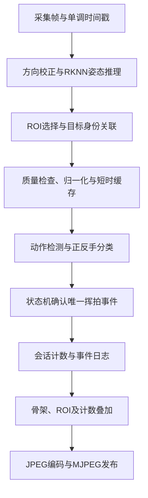
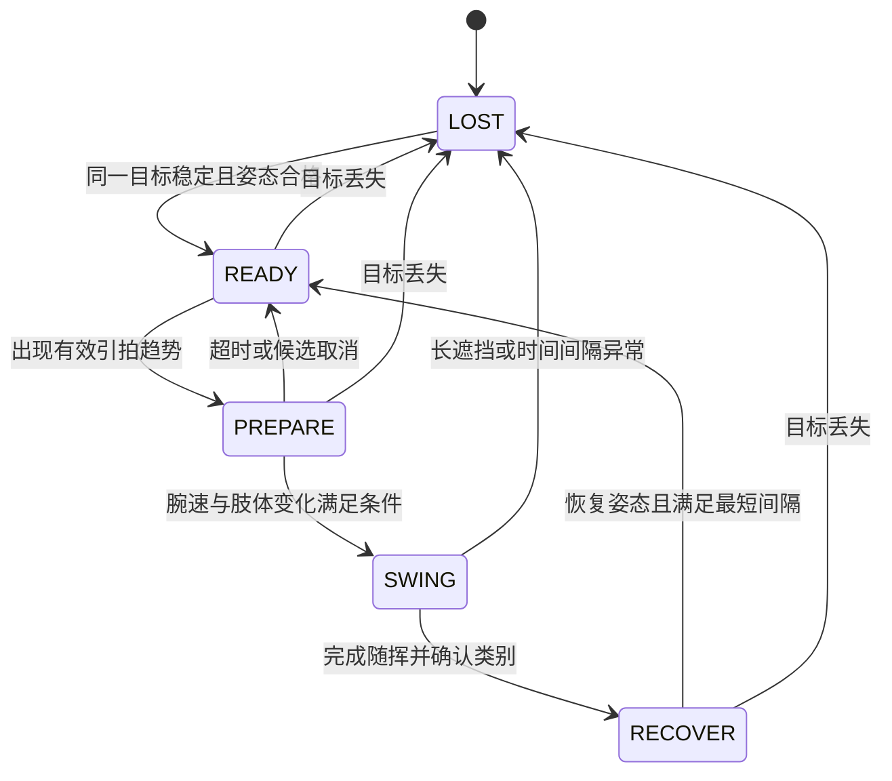

# RK3568 网球正反手分析、计数与预览叠加方案

版本：方案评审稿，2026-11-08。仅新增设计文档，尚未修改推理、计数或预览功能代码。

## 1. 推荐方案与适用范围

推荐基于 `examples/v8_pose_1.0` 的现有摄像头推理和 MJPEG 预览链路，增加单人身份关联、姿态时序分析、挥拍事件状态机和计数叠加。首版面向固定摄像头下的一名训练者，允许指定持拍手、选择分析 ROI，并要求肩、肘、腕、髋具有足够可见性。

必须区分两种产品口径：

| 模式 | 所需证据 | 输出含义 |
|---|---|---|
| 姿态挥拍计数，推荐首版 | 完整姿态动作序列 | 正手/反手挥拍次数；空挥也可能被识别，不能声称实际击球次数。 |
| 实际击球计数，后续增强 | 姿态加经过验证的球/球拍接触证据 | 正手/反手实际击球次数，接触证据不足不计入已确认击球。 |

如果业务必须排除空挥，应直接按第二种模式规划数据与开发，不能仅修改界面名称。首版不承诺任意转播视角、双打或远距离多人场景。

## 2. 现有代码基础

| 文件/位置 | 已有行为 | 计划接入点 |
|---|---|---|
| `cpp/main.cc` | 摄像头采集、逆时针旋转 90°、颜色转换、RKNN 推理 | 增加可配置方向和时间戳，在推理完成后提取分析特征。 |
| `cpp/postprocess.h`、`cpp/postprocess.cc` | 输出人体框与 17 个关键点，每点含三个分量 | 按解码逻辑确认第三项为关键点分数，不能解释为深度。 |
| `draw_pose_results()` | 按 ROI 筛选并绘制人体框和骨架 | 分类质量检查独立实现，不能因为画出了骨架就认为关键点有效。 |
| `cpp/mjpeg_server.*` | 提供 JPEG 帧发布和网页 ROI 交互 | 首版复用发布方式，计数直接烧录到画面。 |
| `utils/image_drawing.h` | `draw_text()` 仅支持 ASCII | 首版使用英文缩写；中文需要额外字体方案。 |
| `cpp/CMakeLists.txt` | 明确列出可执行文件编译源 | 新增分析 `.cc` 后显式加入目标；现有 `GLOB SRCS` 不意味着文件自动参与编译。 |

当前 ROI 主要影响筛选/显示，不代表 NPU 只推理 ROI。首版可以继续全帧推理，在结果侧限定分析对象；若将来裁剪 ROI 推理，需要重新处理 letterbox、坐标回映及网页 ROI 坐标。

## 3. 总体流程



首版使用一个分析线程拥有状态机和计数。预览线程只发布编码后的帧，不得按浏览器请求次数或连接数量更新计数。多客户端看到同一事件快照。

## 4. 姿态输入与特征

COCO 17 点采用从 0 开始的索引：左/右肩 5/6，左/右肘 7/8，左/右腕 9/10，左/右髋 11/12。实现前通过可视化确认标签和坐标回映正确。

将肩中点或髋中点作为平移中心，使用稳定躯干尺度归一化。可组合肩髋中点距离与可靠肩宽，避免侧身时肩宽接近零导致除法放大噪声。尺度过小、异常骨长或腕点低质量时标记缺失。

主要特征：持拍腕相对躯干轨迹、腕速峰值、肘角变化、肩髋连线角度、左右腕距离、双手同步性、动作前后位置变化，以及关键点缺失掩码。速度按真实时间差计算，并减去躯干整体平移，降低跑动影响；不使用“每帧像素差”的固定阈值。

首版人工配置 `handedness=right/left`，固定机位示范正反手用于校准视角。肩线在二维图像中退化、身体方向不明或动作不完整时拒绝分类。不能直接复制 Tennis-Vision 的 `(x,z)` 规则：这里第三分量不是 z。手臂跨中线也不能单独决定类别，因为正手随挥会跨中线。

建议缓存约 1～2 秒的关键点而非完整原图；以 30 Hz、2 秒、17×3 个 float 估算，原始关键点约 12 KB/人，另加时间戳、框和状态。实际容量按配置上限分配。

## 5. 动作识别与计数状态机

### 5.1 分类方法

初版采用视角校准后的时序规则：检测准备、引拍、加速、随挥和恢复的变化，结合持拍手及动作早期轨迹判断正反手。腕速仅触发动作候选，不直接计数；不能通过“手腕在身体左边/右边”逐帧累加。

若规则在限定场景仍不能达到验收目标，离线训练逻辑回归、树模型或小型 TCN，分类为正手、反手、其他动作。输入固定时间跨度的归一化姿态和缺失掩码；拒绝低质量窗口。优先在 CPU 运行小模型，只有实测需要时才研究 RKNN 转换，避免与姿态 NPU 推理争用。

### 5.2 状态转换



在 `SWING → RECOVER` 时提交一次事件，然后才能更新对应计数。计数条件为：目标身份可靠、动作持续时间合理、有效帧比例达标、分类通过阈值且事件尚未提交。无法分类但确认完整挥拍的事件记为 `UNKNOWN`；发球或其他已识别动作记为 `OTHER`；纯噪声候选取消且不计数。

初始调参范围可设动作持续 0.20～1.50 秒、最短事件间隔 0.30～0.60 秒、长丢失阈值约 0.30 秒。均为实验起点，必须用快节奏击球和慢动作样本调整。时间间隔只是辅助防抖，不能代替“必须重新引拍”的状态约束，否则会重复计数或漏掉连续动作。

短暂丢点只保留不确定状态，不允许用补点制造完整击球。长间隔、摄像头重连、方向/ROI/持拍手修改均清空未完成动作和特征历史。已提交会话计数保留，显式 Reset 或新建会话才清零。事件使用递增编号，重绘帧不重复提交。

## 6. 目标关联、多人和 ROI

首版在 ROI 中锁定一名训练者，以 IoU、中心距离和人体尺度变化关联前后帧目标。检测数组下标不能作为身份。匹配不确定或多人交叉时暂停分析，不能静默换人后继续累计。

ROI 为空时应要求选择目标或进入暂停状态，避免对任意路人统计。短暂出 ROI 暂停并清除未完成动作；稳定返回且身份可确认后继续会话。长时间离开后要求重新确认目标。多人独立计数作为后续功能，需要持久 track_id 和每人独立状态机、缓存及统计。

## 7. 预览画面显示与交互

建议显示：

```text
TENNIS | SWING MODE | RIGHT HAND
FH: 12  BH: 8  OTHER: 1  UNKNOWN: 2
LAST: BACKHAND   STATE: READY
TARGET: LOCKED   ANALYSIS: 18 Hz
```

数字仅为界面示意。`FH` 表示正手，`BH` 表示反手；画面明确显示 `SWING MODE`，避免把空挥识别理解为实际接触统计。姿态不合格时显示 `LOW QUALITY`，目标丢失时显示 `PAUSED`，保留已有总数。

接入顺序：推理结果生成 → 取 ROI 和关联目标 → 更新分析器 → 原有骨架绘制 → RGB 转 BGR → 完成 ROI 外恢复和边界绘制 → 绘制计数 HUD → `imencode` → `preview_server.publish()`。

HUD 必须放在 ROI 外图像恢复之后，否则位于 ROI 外的计数会被原图覆盖。现有相机默认旋转 90°，应先验证实际安装方向并配置化，保证人体在分析坐标系中直立；旋转、镜像、ROI 和骨架坐标必须统一。

首版直接在 BGR `frame` 上使用 OpenCV `putText()` 绘制 ASCII；其默认字体也不能直接满足中文显示。若要求画面中文，评估 FreeType 或预渲染字库的部署成本。网页可以中文说明缩写，但必须保证视频画面本身包含计数。

建议后续提供 Start/Pause、Reset、持拍手设置和 ROI 应用功能。服务线程仅发送命令，由分析线程在帧边界执行，统一更新会话状态。Reset 需作为显式用户操作；浏览器刷新和客户端断连均不能自动清零。

## 8. 建议模块边界

| 拟新增/修改项 | 职责 |
|---|---|
| `cpp/tennis_analyzer.h/.cc` | 姿态质量、目标关联、特征缓存、动作状态机和事件提交；尽量独立于 RKNN 和 HTTP。 |
| 分析配置 | 持拍手、模式、质量阈值、时间阈值、方向和 ROI 变更处理策略。首版可从命令行/配置文件读取。 |
| `cpp/main.cc` | 时间戳、分析调用、HUD 叠加与会话生命周期。 |
| `cpp/mjpeg_server.*` | 需要网页控制时才新增命令传递接口；纯画面计数无需修改 JPEG 发布协议。 |
| `cpp/CMakeLists.txt` | 显式加入新源文件并验证目标交叉编译。 |
| 事件日志 | 保存 session_id、event_id、时间、类别、分数、质量、算法版本及累计值，支持复核。 |

这些均是计划接口，当前尚不存在新增实现。建议先补充文件回放/关键点回放入口，使同一动作可重复验证，再连接现场摄像头。

## 9. RK3568 可行性和性能评估

**判断：限定场景的姿态挥拍计数具备工程可行性；实际识别精度和实时帧率待板端验证。** 官方 RKNN Model Zoo 已列出 RK3568 的 YOLOv8 Pose INT8 支持，说明姿态推理有部署基础，不代表网球任务已验证。[官方模型库](https://github.com/airockchip/rknn_model_zoo)、[官方姿态示例](https://github.com/airockchip/rknn_model_zoo/blob/main/examples/yolov8_pose/README.md)。

新增 CPU 规则、关键点缓存和计数 HUD 的计算规模通常小于姿态推理及 JPEG 编码，这是结构上的预期，仍需 profiling。首版继续复用已验证的模型输入尺寸，不为追求帧率擅自降低尺寸，否则腕点误差可能先导致分类失效。

| 阶段 | 测量内容 | 优化方向 |
|---|---|---|
| 摄像头与预处理 | 取帧延迟、旋转/颜色转换、缓存积压 | 测试方向配置，减少无用复制，评估已有 RGA 路径。 |
| NPU 与后处理 | 推理耗时、后处理耗时、关键点误差 | 检查 RKNN 模型/运行库/驱动兼容性，使用网球场景量化样本。 |
| 时序分析 | 单帧耗时、缓存长度、事件确认延迟 | 控制单人分析，固定内存容量。 |
| 预览 | 绘制、JPEG 编码、网络延迟、多客户端负载 | 降低预览分辨率/编码质量或发布频率，分析频率独立记录。 |

记录各阶段 p50/p95、有效分析 Hz、端到端显示延迟、CPU/NPU使用情况、内存和温度。建议原型目标为分析频率 ≥15 Hz、预览 ≥10 fps，完成动作后 1 秒内更新计数；均为待验证目标，不是性能承诺。低采样率可能漏掉快速动作，应降级提示，不能只保持流畅预览掩盖分析不足。

纯串行链路的每帧时间为各阶段耗时之和；多线程流水线的吞吐还受最慢阶段和资源争用限制。若取最新帧以降低延迟，必须保留真实时间戳并检测长间隔，不能把跳帧当成相邻采样。长时间测试应覆盖热降频，至少运行 30 分钟检查内存与延迟趋势。

实际击球增强版需额外检测小球/球拍。高速小球在普通帧率与曝光条件下可能消失，人体模型也不输出球拍；添加模型会增加 NPU、CPU和内存带宽竞争。声音可辅助定位冲击时间，但无法单独区分邻场击球、落地和目标球员接触。此阶段应单独立项验证。

## 10. 主要问题与处理策略

| 问题 | 后果 | 处理 |
|---|---|---|
| 侧身肩线退化、背对摄像头 | 正反手左右关系不稳定 | 固定推荐视角、短时特征、质量拒绝，必要时训练时序分类器。 |
| 腕点遮挡、运动模糊、INT8误差 | 假速度峰值或丢动作 | 合理曝光与照明、关键点质量/骨长检查、代表性量化数据。 |
| 准备动作、跑动、捡球、空挥 | 误计数 | 负样本和完整动作约束；空挥是否计入由模式决定。 |
| 正手随挥跨身 | 被误判反手 | 结合引拍至加速阶段，不能只观察随挥终点。 |
| 双手反手、单手反手、左手持拍 | 规则泛化失败 | 明确持拍手，分别覆盖数据；双腕靠近不直接判反手。 |
| 发球、截击、高压球 | 污染正反手次数 | 首版排除或记 OTHER；明确不覆盖的动作类型。 |
| 多人、身份切换、ROI变化 | 串人累计、半个动作被计数 | 锁定身份、模糊时暂停，变更时清空动作状态。 |
| 丢帧、摄像头断开、镜头移动 | 速度异常、动作断裂 | 时间戳检测、重新稳定、暂停未完成事件。 |
| 冷却时间过长或过短 | 漏计快动作或重复计数 | 状态转换为主、间隔为辅，用连续击球测试调参。 |

## 11. 验证与分阶段决策

1. **确认需求**：选择挥拍或实际击球口径，固定首版人数、视角、左右手及是否包含截击。推荐默认单人、人工配置持拍手、仅正反手底线挥拍。
2. **建立数据**：采集不同参与者的正反手、左右手和负样本，标注完整动作边界、类别、真实接触与可见性。按人员和场次隔离测试集，不能随机拆相邻帧。
3. **验证基础链路**：测板端姿态质量与采样频率；保存姿态序列离线验证规则，确认二维信息是否足够。若腕点本身不可用，先调整拍摄和模型。
4. **再决定编码**：基线达到目标后实现 C++ 分析器、事件去重和 HUD；规则不足则先验证轻量模型收益，再考虑部署。
5. **验收与回归**：执行同一序列重放、遮挡、换人、Reset、ROI变更、重连、多客户端、连续快挥及负样本测试，并与事件日志核对画面计数。

建议受控场景验收目标：正反手事件宏平均 F1 ≥0.90、每类总计数误差 ≤5%、可分类有效挥拍覆盖率 ≥85%，负样本误触发 ≤1 次/10 分钟。每类误差同时报告绝对次数；真值为零时不计算百分比。评估采用预先固定时间容差的一对一事件匹配，防止重复检测被当成正确。以上均为拟议门槛，最终需结合数据量和现场要求确定。

首个实施决策应依据“姿态质量、时序可分性、板端性能”三项实测，而不是模型支持平台列表。若只需训练者挥拍统计，优先实现本方案的轻量版本；若需要比赛级实际击球统计，应先解决接触证据和跨视角泛化。

参考：[本地示例说明](README.md)、Tennis-Vision 的 `docs/public/FOREHAND_BACKHAND_TECHNICAL_PLAN_ZH.md`、[官方 RKNN 姿态示例](https://github.com/airockchip/rknn_model_zoo/blob/main/examples/yolov8_pose/README.md)。外部资料核对日期为 2026-11-08；本文未进行板端运行测试。
